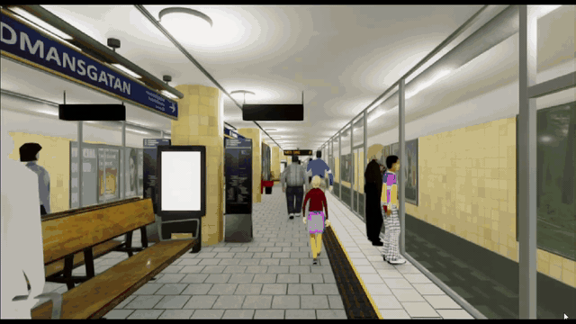
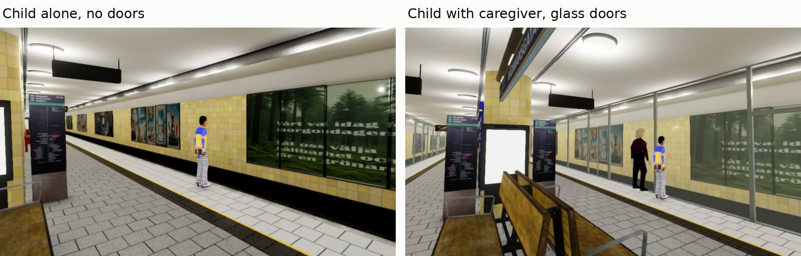
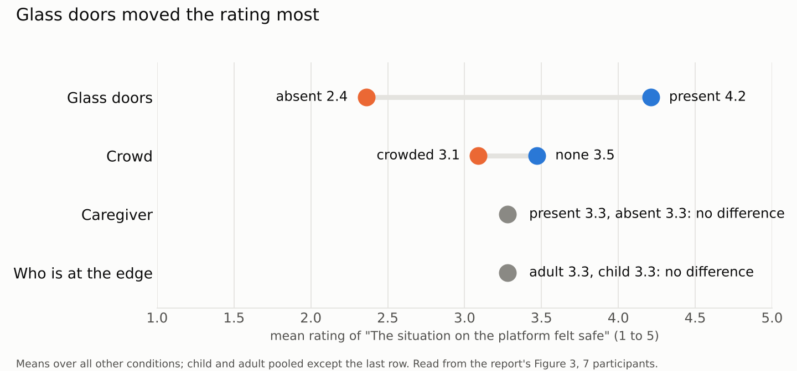
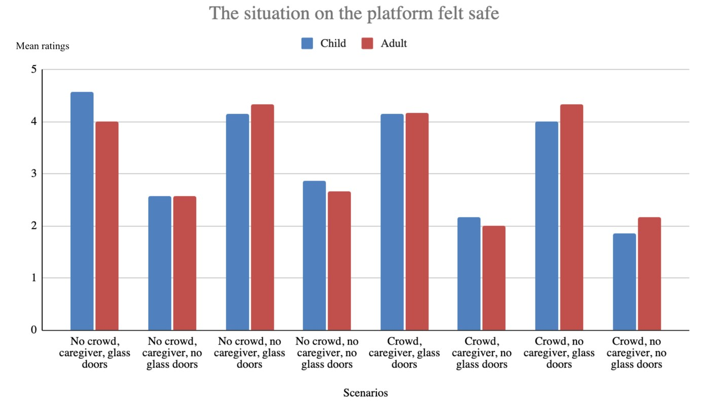
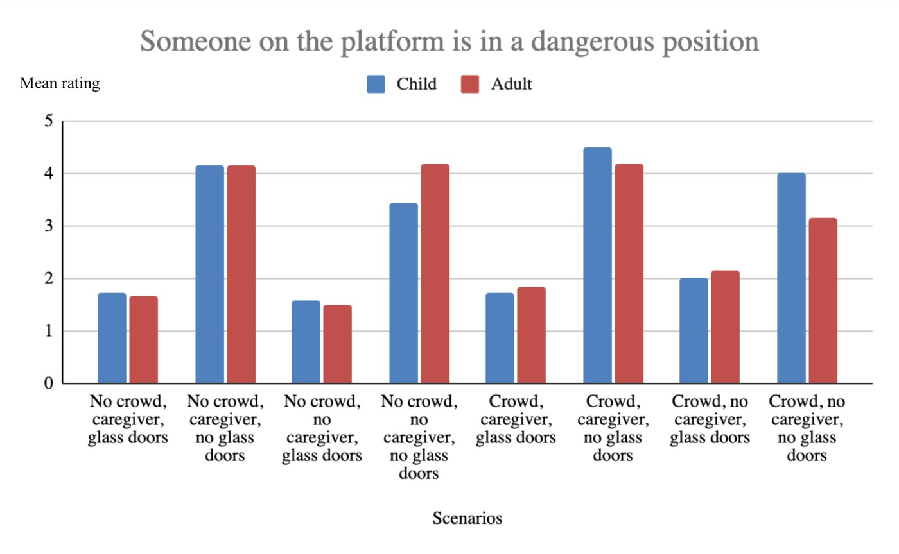
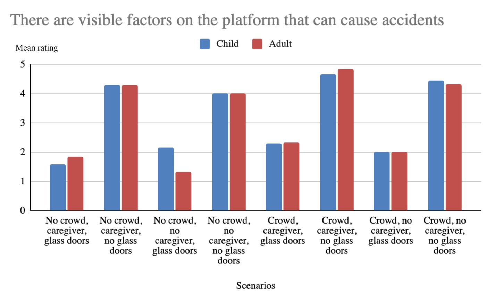

# Perceived Safety on a T-bana Platform: A VR Study

     

What makes a subway platform feel safe? We built 16 versions of a Stockholm T-bana platform in Unity and had seven people rate each one in a Meta Quest 2. The study tests four things: whether a child or an adult stands at the edge, whether the platform is crowded, whether a caregiver is there, and whether glass platform doors separate people from the tracks.

It was a team project in the Human Perception course (DM2350) at KTH, supervised by Christopher Peters.

## About the project

Perceived safety depends on more than real risk. Who is on the platform and how the space is built both change how people feel. Studying that in a real station is hard, and nobody should be put near a platform edge for an experiment. VR lets us change one thing at a time and keep everything else fixed.

We started from an existing 3D reconstruction of a Stockholm T-bana platform and the KTH crowd simulator (see Acknowledgements). The question: **does a child at the platform edge, a crowd, a caregiver or glass doors change how safe people feel?**

## My part

I created the scenarios in Unity (layout, avatar placement and the four switchable factors), ran the user sessions, and did the quantitative and qualitative analysis.

## How the study works

| | |
|---|---|
| Design | Within-subject, repeated measures. Every participant sees all 16 scenes |
| Factors | Actor at the edge (child or adult), crowd (none or high), caregiver (present or absent), glass doors (present or absent). 2×2×2×2 = 16 scenes |
| Participants | 7 students, 18 to 32 years, normal or corrected vision, voluntary and anonymous |
| Hardware | Meta Quest 2, brought to the participants instead of a lab |
| Procedure | Fixed spot on the platform, about 10 seconds per scene in random order, 20 to 30 minutes in total |
| Survey | Three Likert questions (1 to 5) after each scene, answered inside the headset so immersion is not broken: *the situation felt safe*, *someone is in a dangerous position*, *visible factors could cause accidents* |
| Open feedback | Free text at the end: which factor mattered most, which scene felt least safe |
| Analysis | Mean ratings per scene, descriptive comparison, simple themes from the comments. No statistical tests at n = 7 |

Two of the 16 scenes. The other 14 combine the same four factors.

## Results

Mean rating for *"The situation on the platform felt safe"* (5 = strongly agree), averaged over all other conditions.

- **Glass doors were the biggest effect:** about 4.2 with doors and 2.4 without. Participants also named the doors as the most important factor in their comments.
- **Crowds made it worse where there were no doors.** For the child, the average without doors fell from about 2.7 to 2.0 when the platform was crowded.
- **The lowest rating** was a child at the edge of a crowded platform with no caregiver and no doors (about 1.9).
- **A caregiver and the actor's age made no visible difference to the average** on this question. On "someone is in a dangerous position" the adult was sometimes rated worse than the child. We would need more participants to say more.
- **Comments agreed with the numbers.** People described doors as reassuring, crowds as stressful because of less personal space, and an unsupervised child near the edge as uncomfortable.

### All 16 scenes, three questions

Original charts from the report. Blue is the child, red is the adult. Values are mean ratings from 1 to 5.

Two more questions

 

 

## Limitations

- Seven participants and no statistical tests: these are patterns, not proof.
- Avatars were static with minimal idle animation, scenes lasted only 10 seconds, and there was no audio.
- Participants stayed on a fixed spot and could not move.
- Some of the 16 conditions were quite similar. Fewer, clearer scenarios would have been easier to separate.
- Time for pilot testing was short because adapting the existing Unity project took longer than planned.

## Future work

Vary the distance between the child, the caregiver and the platform edge to find where a scene starts to feel dangerous. Add moving avatars, sound and longer scenes, let people walk, and recruit more participants.

## Repository

The Unity project is in `Crowd Simulator and Tbana Reconstruction/` (`Assets`, `Packages`, `ProjectSettings`). Open it with Unity 2022.3. The images and GIF in this README are in `assets/`.

## Team

William Sassner Andersson, Amanda Danielsson, Amanda Falk, Fuad Mammadov, Viggo Halvarsson Skoog. Demo video: [YouTube](https://youtu.be/A3jLR6CQvFM).

---

# Original project README

## Acknowledgements

Forked from: https://github.com/KTH-High-Density-Crowd-Simulator/Crowd-Simulator-and-Tbana-Reconstruction.git

### Jack Shabo

- Original implementation of high density crowd simulator.
- [High Density Simulation of Crowds with Groups in Real-Time](https://urn.kb.se/resolve?urn=urn:nbn:se:kth:diva-210564)

### PVK Software Engineering group and Julian Ley

- Created subway reconstruction.
- [Metroped Interactive](https://github.com/JulianLey/MetropedInteractive)

### Jenna Smulter
- Improvements and bug fixes to crowd simulator. Owner of the forked repo.

### Anton Porsbjer
- Improvements and bug fixes to crowd simulator. Owner of the forked repo.
